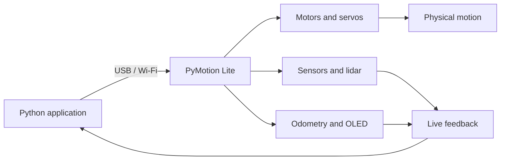

<div align="center">

<a href="README.md"></a>&nbsp;&nbsp;<a href="README_CN.md"></a>

<h1>PyMotion Lite</h1>

<p><strong>Take Python beyond the screen.</strong></p>
<p>From code to motion, and from motion back to data—a Python-native controller for robotics learning, rapid prototyping, and intelligent hardware.</p>

<p>
  <a href="https://pymotion.mintlify.site"></a>&nbsp;
  &nbsp;
  &nbsp;
  
</p>

</div>

PyMotion Lite brings DC motors, PWM servos, TTL bus servos, sensors, lidar, odometry, OLED output, and device status into one consistent `pm.lite` API. Start with USB for dependable bench testing, then move to Wi-Fi for untethered robots without changing the way your application is structured.



## Why PyMotion Lite

| Feature | What it gives you |
| --- | --- |
| Python-native API | Work with real device capabilities without first implementing low-level protocols |
| Control plus feedback | Send motion targets and read encoders, measured speed, sensors, power, and device status |
| One API for USB and Wi-Fi | Move from desk-side development to mobile and wireless projects smoothly |
| Real-time workflows | Stream multiple data sources while continuously updating actuator targets |
| Safety in the normal workflow | Token authentication, control ownership, command expiry, explicit stop, and clean shutdown |
| Ready to use | Bundled Python 3.12, offline dependencies, Quick Start examples, and a complete learning course |

## Environment

- 64-bit Windows 10 or Windows 11.
- No existing Python installation is required; CPython 3.12 and the required offline wheels are included.
- Visual Studio Code is recommended; the dedicated SDK terminal works without VS Code.
- USB connections require a data-capable USB cable.

## Quick start

Extract the complete SDK package to a short path, for example `D:\PyMotion_Lite_Windows`.

### 1. Prepare the SDK folder

`D:\PyMotion_Lite_Windows` must include at least:

```text
D:\PyMotion_Lite_Windows\
├─ install.bat
├─ open-sdk-vscode.bat
├─ open-sdk-terminal.bat
├─ examples/
├─ runtime/
├─ sdk/
└─ wheels/
```

Do not copy `install.bat` by itself, and do not move, remove, or modify `runtime`, `sdk`, `wheels`, or `examples`.

### 2. Double-click the installer

Double-click `D:\PyMotion_Lite_Windows\install.bat` and wait until the window shows:

```text
Installation completed.
```

The installer uses the bundled Python 3.12 runtime, creates an isolated environment for the current Windows user, and installs the SDK and its dependencies from local wheels. The default environment is:

```text
%LOCALAPPDATA%\PyMotion\LiteSDK\venv-cp312
```

It does not modify the system Python installation or require changes to `PATH`. If installation fails, keep the complete error output and do not retry with a separately copied installer.

### 3. Double-click the SDK workspace launcher

After installation succeeds, double-click `D:\PyMotion_Lite_Windows\open-sdk-vscode.bat`. The launcher:

1. Checks the installed PyMotion Lite SDK 1.0.1 environment.
2. Creates a dedicated VS Code workspace under the current user profile.
3. Copies the examples into an editable workspace so the original SDK package stays unchanged.
4. Binds the Python extension and Code Runner to the SDK interpreter.
5. Opens PyMotion Lite SDK in a new VS Code window.

If Visual Studio Code is not found, install VS Code and run the launcher again. Without VS Code, double-click `open-sdk-terminal.bat` to open a terminal with the SDK environment activated.

### 4. Connect your PyMotion Lite board

Before connecting, attach a data-capable USB cable and make sure the board is powered normally. Then set the board’s current Token in the VS Code terminal or dedicated SDK terminal.

PowerShell:

```powershell
$env:PYMOTION_AUTH_TOKEN = "your device Token"
```

Command Prompt:

```bat
set "PYMOTION_AUTH_TOKEN=your device Token"
```

After connecting USB and setting the Token, run the read-only connection example:

```powershell
python .\examples\quick-start\02-connection.py
```

This example only establishes a USB connection, reads the board status, and closes the connection. It does not drive motors or servos. A successful run prints output similar to:

```text
PyMotion Lite SDK: 1.0.1
Device ID: ...
Transport: usb
State: ...
Status age: ... s
```

Once you see the device ID, `Transport: usb`, and board status, the SDK is communicating with PyMotion Lite correctly. You can then continue with the other examples under `examples\quick-start` or follow the numbered lessons in `examples\lite-learning-course`.

To access the board from your own Python program, use the same `pm.lite` entry point:

```python
import pymotion as pm

with pm.lite.connect(transport="usb") as lite:
    print(lite.connection.device_id)
    print(lite.status().state)
```

## Where to go next

| Goal | Start here |
| --- | --- |
| Learn the SDK and make the first connection | [Quick Start](examples/quick-start) |
| Learn motors, servos, sensors, and real-time control | [Lite Learning Course](examples/lite-learning-course) |
| Run examples without VS Code | Double-click `open-sdk-terminal.bat` |
| Look up features, APIs, and safety constraints | [Online User Manual](https://pymotion.mintlify.site) |

> [!CAUTION]
> Wire motors and servos only while power is disconnected. Use a suitable external actuator supply, lift wheels off the work surface, and clear the mechanism’s full range of motion. Software stops and communication timeouts do not replace an immediately accessible physical power disconnect.
