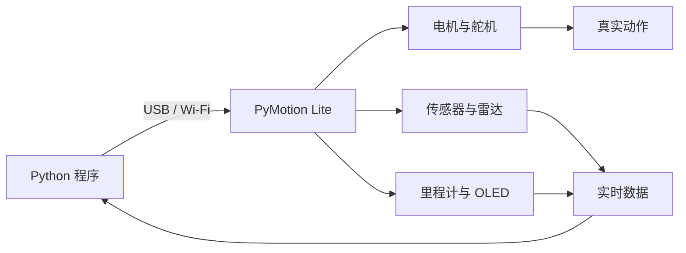

<div align="center">

<a href="README.md"></a>&nbsp;&nbsp;<a href="README_CN.md"></a>

<h1>PyMotion Lite</h1>

<p><strong>让 Python 不只停留在屏幕里。</strong></p>
<p>从代码到动作，从动作到反馈——一块面向机器人学习、原型验证与智能硬件项目的 Python 原生控制器。</p>

<p>
  <a href="https://pymotion.mintlify.site"></a>&nbsp;
  &nbsp;
  &nbsp;
  
</p>

</div>

PyMotion Lite 将直流电机、PWM 舵机、TTL 总线舵机、传感器、雷达、里程计、OLED 与设备状态统一到一套清晰的 `pm.lite` API 中。你可以先用 USB 完成稳定调试，再切换到 Wi-Fi 构建无线机器人；应用层代码保持同一种使用方式。



## 为什么是 PyMotion Lite

| 特点 | 你可以获得什么 |
| --- | --- |
| Python 原生 | 公开 API 直接对应设备能力，不必先处理底层通信协议 |
| 控制与反馈一体 | 发出运动目标，同时读取编码器、实测转速、传感器、电源与设备状态 |
| USB / Wi-Fi 同一 API | 从桌面调试平滑切换到移动机器人和无线应用 |
| 实时能力 | 连续接收多源数据，并持续更新电机、舵机等执行器目标 |
| 安全进入正常流程 | Token 认证、控制权、命令有效期、主动停止与异常退出均有明确用法 |
| 开箱即用 | 内置 Python 3.12、离线依赖、快速入门和完整课程例程 |

## 运行环境

- 64 位 Windows 10 或 Windows 11。
- 不要求预先安装 Python；SDK 包已包含 CPython 3.12 和所需离线 wheel。
- 推荐安装 Visual Studio Code；未安装 VS Code 时也可以使用 SDK 专用终端。
- USB 连接需要支持数据传输的 USB 线，仅供电线无法通信。

## 快速开始

建议将 SDK 包完整解压到路径较短的目录，例如 `D:\PyMotion_Lite_Windows`。

### 1. 准备 SDK 目录

`D:\PyMotion_Lite_Windows` 中应至少包含：

```text
D:\PyMotion_Lite_Windows\
├─ install.bat
├─ open-sdk-vscode.bat
├─ open-sdk-terminal.bat
├─ examples/
├─ runtime/
├─ sdk/
└─ wheels/
```

不要只复制 `install.bat`，也不要移动、删除或修改 `runtime`、`sdk`、`wheels` 和 `examples`。

### 2. 双击安装 SDK

双击 `D:\PyMotion_Lite_Windows\install.bat`，等待窗口显示：

```text
Installation completed.
```

安装器会使用包内 Python 3.12，在当前 Windows 用户目录创建隔离环境，并从本地 wheel 离线安装 SDK 与依赖。默认环境位于：

```text
%LOCALAPPDATA%\PyMotion\LiteSDK\venv-cp312
```

此过程不会修改系统 Python，也不要求用户配置 `PATH`。如果窗口提示失败，请保留完整错误信息，不要只复制安装脚本到其他目录重试。

### 3. 双击打开 SDK 工作区

安装成功后，双击 `D:\PyMotion_Lite_Windows\open-sdk-vscode.bat`。启动器会：

1. 检查已安装的 PyMotion Lite SDK 1.0.1。
2. 在当前用户目录创建独立的 VS Code 工作区。
3. 将示例复制到可编辑工作区，避免修改原始 SDK 包。
4. 将 Python 扩展和 Code Runner 使用的解释器绑定到 SDK 隔离环境。
5. 使用新窗口打开 PyMotion Lite SDK。

如果提示未找到 Visual Studio Code，请先安装 VS Code，再重新双击该文件。没有 VS Code 时，可双击 `open-sdk-terminal.bat` 使用已经激活的 SDK 专用终端。

### 4. 连接你的 PyMotion Lite 板卡

连接板卡前，请先接好支持数据传输的 USB 线并确认板卡已经正常供电。然后在打开的 VS Code 终端或 SDK 专用终端中设置板卡当前 Token。

PowerShell：

```powershell
$env:PYMOTION_AUTH_TOKEN = "设备的 Token"
```

CMD：

```bat
set "PYMOTION_AUTH_TOKEN=设备的 Token"
```

完成 USB 连接和 Token 设置后，运行只读连接例程：

```powershell
python .\examples\quick-start\02-connection.py
```

该例程只会建立 USB 连接、读取板卡状态并关闭连接，不会驱动电机或舵机。运行成功后，终端会显示类似信息：

```text
PyMotion Lite SDK: 1.0.1
Device ID: ...
Transport: usb
State: ...
Status age: ... s
```

看到设备 ID、`Transport: usb` 和板卡状态后，说明 SDK 已经能够正常访问 PyMotion Lite。接下来可以继续运行 `examples\quick-start` 中的其他例程，或按照 `examples\lite-learning-course` 的编号顺序学习完整功能。

如果需要在自己的 Python 程序中访问板卡，可以使用同一个 `pm.lite` 入口：

```python
import pymotion as pm

with pm.lite.connect(transport="usb") as lite:
    print(lite.connection.device_id)
    print(lite.status().state)
```

## 从这里继续

| 我想做什么 | 从这里开始 |
| --- | --- |
| 认识 SDK 并完成首次连接 | [Quick Start](examples/quick-start) |
| 学习电机、舵机、传感器与实时控制 | [Lite Learning Course](examples/lite-learning-course) |
| 不使用 VS Code，在专用环境中运行示例 | 双击 `open-sdk-terminal.bat` |
| 查询完整功能、API 与安全约束 | [在线使用手册](https://pymotion.mintlify.site) |

> [!CAUTION]
> 电机和舵机动作前，请在断电状态下完成接线，使用符合要求的外部供电，架空车轮并清空机构运动范围。软件停止与通信超时保护不能替代可立即操作的物理断电措施。
